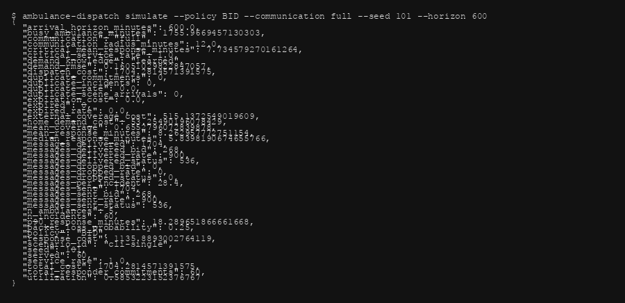
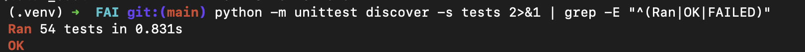
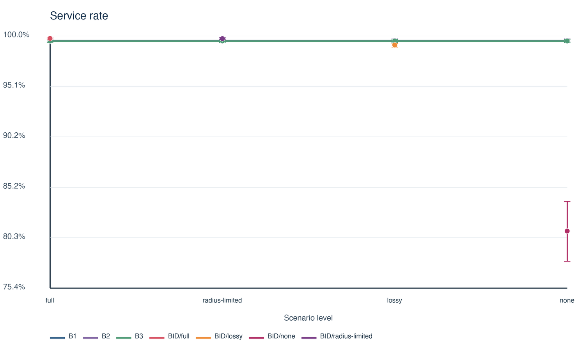
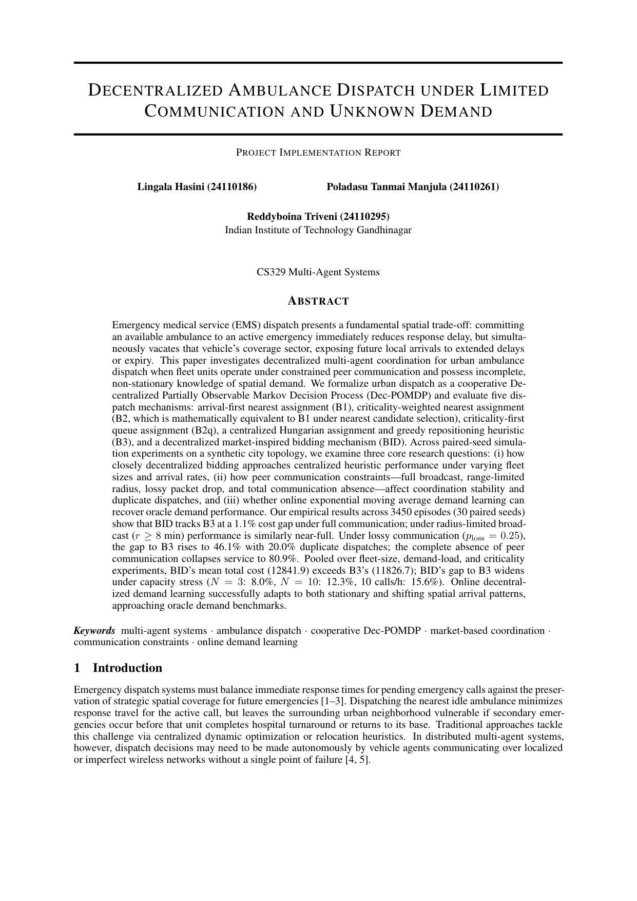

# Cooperative Ambulance Dispatch under Limited Communication and Unknown Demand

Multi-Agent Systems course project, IIT Gandhinagar.

**Team:** Lingala Hasini (24110186) · Poladasu Tanmai Manjula (24110261) · Reddyboina Triveni (24110295)

## Screenshots

| Terminal output | 54 unit tests passing |
|---|---|
|  |  |

| Communication regime results (Exp 4) | Report page 1 |
|---|---|
|  |  |

## Overview

Discrete-event simulation of urban EMS fleet dispatch on a 5×5 Manhattan grid. Five dispatch policies are evaluated under four communication regimes, with optional online demand learning.

**Policies:**
| Policy | Description |
|--------|-------------|
| **B1** | FIFO queue; nearest idle ambulance (min travel time) |
| **B2** | FIFO queue; criticality-weighted nearest (mathematically identical to B1) |
| **B2q** | Criticality-first queue; nearest idle ambulance |
| **B3** | Centralized Hungarian matching heuristic with greedy repositioning |
| **BID** | Decentralized market-based bidding balancing response delay, coverage loss, and home-station vulnerability |

**Communication regimes:** full · radius-limited (r ∈ {2,4,6,8,12} min) · lossy (p ∈ {0,0.1,0.25,0.5,0.75,1}) · none

**Online learning:** EMA demand-rate estimation (η=0.25, hourly bins). Oracle condition uses true rates.

## Repository Structure

```
src/ambulance_dispatch/   Core simulator, policies, demand learning, metrics, CLI
configs/                  default.json, experiment_matrix.json
tests/                    54 unit and integration tests
tools/run_weight_sensitivity.py   One-factor α,β,γ sensitivity runner
report/                   8-page arXiv-style report (main.tex, main.pdf), asset builder, plots
scripts/run_final.sh      One-command full experiment suite runner
results/final_30_seed/    Final 30-seed results (pre-computed)
screenshots/              Generated screenshots and result plots
```

> **Note:** `results/final_30_seed/incident_outcomes.csv.gz` (~32 MB) is excluded from the repository
> by `.gitignore`. It is not referenced by any report script and is not needed to reproduce the paper.

## Installation

```bash
python3 -m venv .venv && source .venv/bin/activate
pip install --upgrade pip && pip install -e ".[dev]"
```

## Commands

```bash
# Unit tests
python -m unittest discover -s tests -v

# Single simulation episode
ambulance-dispatch simulate --policy BID --communication full --seed 101 --horizon 600

# Small pilot experiment (2 seeds)
ambulance-dispatch experiments --seeds 2 --horizon 600 --output-dir results/pilot_test

# Weight sensitivity (2-seed pilot)
python tools/run_weight_sensitivity.py --seed-count 2 --output results/pilot_weights --allow-dirty

# Build report assets from existing 30-seed results
python report/build_report_assets.py results/final_30_seed \
  --weight-sensitivity-dir results/final_30_seed/weight_sensitivity \
  --output-dir report/generated

# Compile the report (requires tectonic)
tectonic report/main.tex   # produces report/main.pdf (8 pages)
```

## Configuration

Edit `configs/default.json` or pass CLI flags:
- Ambulances: `--ambulances <N>` (default 5)
- Demand rate: `--rate <λ>` (default 5.0 calls/h), pattern: `--pattern {uniform,hotspots,shifting}`
- Communication: `--communication {full,radius-limited,lossy,none}`, `--comm-radius`, `--loss-prob`
- Weights: `alpha` (1.0), `beta` (8.0), `gamma` (8.0), `rho` (120.0) in `configs/default.json`

## Reproduce the Paper

The 30-seed results are pre-computed in `results/final_30_seed/`. To regenerate report assets and the PDF from these results:

```bash
python report/build_report_assets.py results/final_30_seed \
  --weight-sensitivity-dir results/final_30_seed/weight_sensitivity \
  --output-dir report/generated
tectonic report/main.tex
```

A full rerun of all experiments is optional (~5-6 min (about 4 min for the main run plus 1.2 min for weight sensitivity, per the manifests)):

```bash
bash scripts/run_final.sh   # reruns all 3450 policy episodes + 1080 weight-sensitivity runs
```

| Report item | Generator script | Input results file |
|---|---|---|
| Fig. 1 (comm/learning plots) | `report/build_report_assets.py` | `results/final_30_seed/report_plots/exp4_communication_*.png` |
| Fig. 2 (weight sensitivity plots) | `report/build_report_assets.py` | `results/final_30_seed/report_plots/exp8_weight_sensitivity_*.png` |
| Table 3 (proposal results) | `report/build_report_assets.py` → `generated/proposal_results_table.tex` | `results/final_30_seed/summary_metrics.csv` |
| Table 4 (communication outcomes) | `report/build_report_assets.py` → `generated/communication_table.tex` | `results/final_30_seed/summary_metrics.csv` |
| Table 5 (message counts) | `report/build_report_assets.py` → `generated/message_table.tex` | `results/final_30_seed/raw_results.csv` |
| Table 6 (weight sensitivity) | `report/build_report_assets.py` → `generated/weight_sensitivity_table.tex` | `results/final_30_seed/weight_sensitivity/summary_metrics.csv` |
| Table 7 (deviation analysis) | `report/build_report_assets.py` → `generated/deviation_table.tex` | `results/final_30_seed/deviations/deviation_summary.csv` |
| All macros in text | `report/build_report_assets.py` → `generated/result_macros.tex` | `results/final_30_seed/summary_metrics.csv` |

## Validation

```bash
python report/validate_results.py results/final_30_seed \
  --weight-sensitivity-dir results/final_30_seed/weight_sensitivity
```

