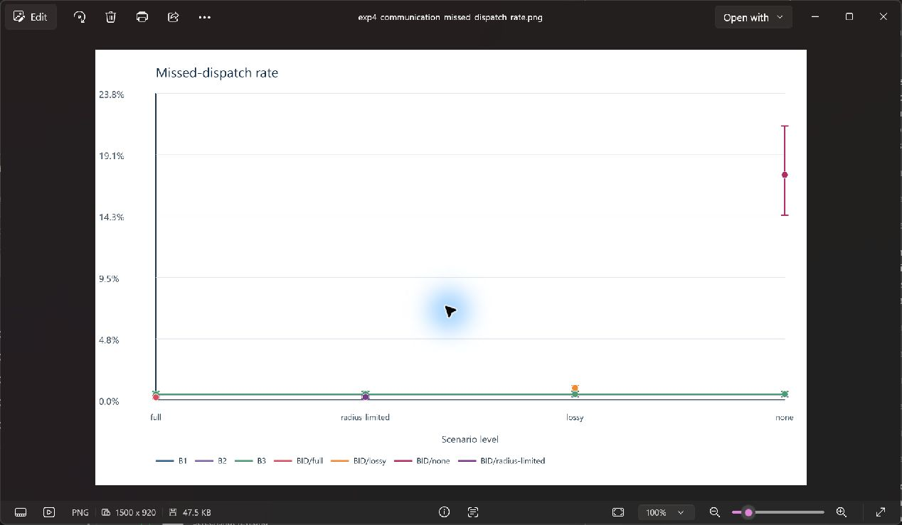
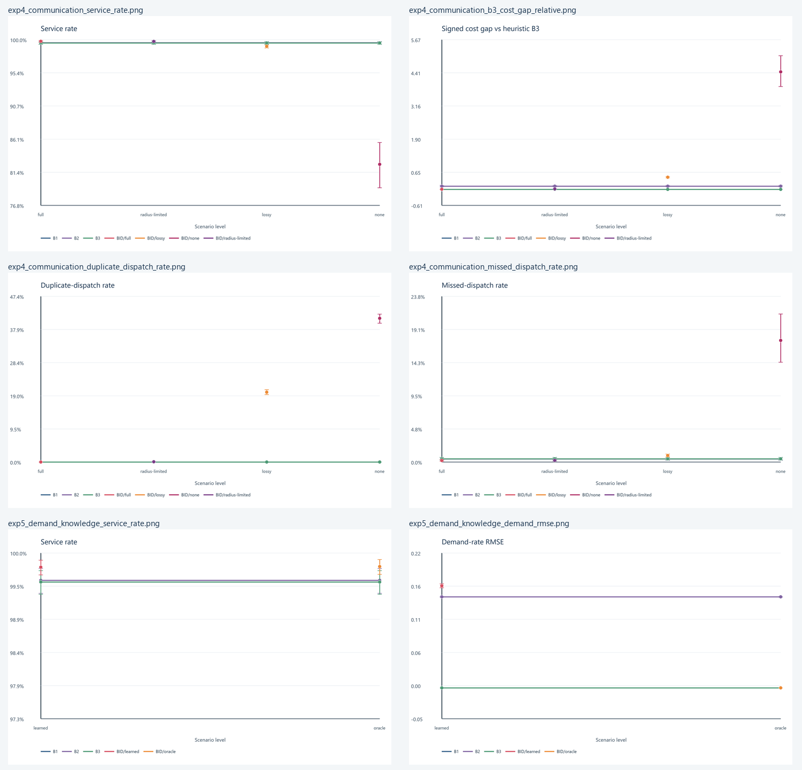

# The Price of Decentralization in Ambulance Dispatch

Reproducible synthetic study for the CS329 Multi-Agent Systems project. It evaluates cooperative ambulance dispatch when each agent has local demand estimates and peer communication may be limited or absent. The report completes the original project-review proposal; the proposal PDF remains unchanged in `docs/reference/`.

## Objective and model

The study compares decentralized bidding with three baselines in a synthetic city. Its shared team cost combines criticality-weighted response time, uncovered non-home demand while an ambulance is busy, home-zone demand during absence, and call expiration penalties. Bid and payoff equations use the same `alpha`, `beta`, and `gamma` terms. See [MODEL_DESIGN.md](MODEL_DESIGN.md) for equations, event ordering, information boundaries, movement, communication semantics, and assumptions.

The simulator uses a weighted 5×5 grid, shortest-path travel, zone-level Poisson arrivals, criticality-specific deadlines, a pending-call queue, and an arrival horizon. Ambulances become busy for response travel, on-scene time, return travel to the dispatch node, or repositioning. Call announcements are public to all policies. Peer messages carry bids, status, and demand estimates.

Implemented policies:

- **B1:** nearest feasible idle ambulance.
- **B2:** minimum `alpha × criticality × response time`. For a given call, this is the same ordering as B1 because the multiplier is common across candidate ambulances; the proposal's B1/B2 definitions are retained.
- **B3:** centralized Hungarian assignment using global positions and true rates, followed by greedy coverage-aware repositioning. B3 is a heuristic, not a certified optimum.
- **BID:** each feasible agent scores with its local rate and state view. Every local minimum commits; incomplete views can create duplicate dispatches.

Communication regimes are **full**, **radius-limited**, **lossy**, and **none**. “None” disables peer messages but preserves the shared call signal. Zone owners update rates hourly with a discounted estimator and send their estimates through the peer channel. Learned BID uses received rates; oracle BID receives true rates as an information reference. B3 also uses true rates. Response means are conditional on calls served before deadline and are interpreted alongside service and miss rates.

The reported performance gap is empirical and signed against heuristic B3:

```text
(policy cost - B3 cost) / B3 cost, when B3 cost > 0
```

Negative values mean the policy beat this heuristic for that matched seed. The value is undefined at zero B3 cost; the absolute difference is retained. It is not a theoretical price-of-anarchy bound.

## Results and report

The original seven proposal experiment families are in [`results/full_20261121/`](results/full_20261121/): 1,760 policy episodes over seeds 1000–1019, plus the recorded unilateral-deviation cases. The independent one-factor sensitivity extension is in [`results/improvements_20261121/weight_sensitivity/`](results/improvements_20261121/weight_sensitivity/): 720 policy episodes across nine settings and the same 20 seeds. The latter separately varies alpha, beta, and gamma; it does not replace experiment 7, which changes beta and gamma together.

The final report source and compiled PDF are [report/main.tex](report/main.tex) and [report/main.pdf](report/main.pdf). The report includes CSV-generated results tables, actual experiment plots, discussion, limitations, and the contribution table. Selected plots:

- [Communication and service plot](results/full_20261121/report_plots/exp4_communication_service_rate.png)
- [Communication and missed-dispatch plot](results/full_20261121/report_plots/exp4_communication_missed_dispatch_rate.png)
- [Demand-knowledge RMSE plot](results/full_20261121/report_plots/exp5_demand_knowledge_demand_rmse.png)
- [Independent beta sensitivity plot](results/improvements_20261121/weight_sensitivity/report_plots/exp8_weight_sensitivity_beta_b3_cost_gap_relative.png)
- [All original report plots](results/full_20261121/report_plots/)
- [All independent sensitivity plots](results/improvements_20261121/weight_sensitivity/report_plots/)

`results_overview.png` is a generated plot collage. The image below is a genuine screenshot of the results plot displayed in the desktop Photos viewer; it is preserved alongside the underlying plot.





## Repository structure

```text
configs/                         default, seven-family, and weight-sensitivity settings
docs/reference/                  unchanged proposal and submitted feedback/guidelines
src/ambulance_dispatch/           simulator, demand, policies, learning, metrics, runner
tests/                            deterministic unit and integration tests
tools/run_weight_sensitivity.py   independent alpha/beta/gamma sensitivity runner
results/full_20261121/            original proposal-family raw data, logs, plots, report assets
results/improvements_20261121/    corrected independent weight-sensitivity results
report/main.tex                   eight-page report source in community arXiv preprint style
report/main.pdf                   compiled report
report/generated/                 CSV-generated LaTeX tables and result macros
AUDIT/                            baseline evidence and technical audit records
MODEL_DESIGN.md                   equations, assumptions, and simulator semantics
IMPLEMENTATION_PLAN.md            staged scope, decisions, and completion record
CHANGE_IMPACT.md                  end-to-end change propagation matrix
FINAL_AUDIT.md                    final verification evidence
FINAL_ISSUES.md                   remaining items that need external confirmation
```

## Requirements and installation

- Python 3.10 or later.
- Pillow 10 or later for plots and screenshots.
- Tectonic or a compatible LaTeX toolchain to rebuild the PDF.

From the repository root in PowerShell:

```powershell
python -m venv .venv
.\.venv\Scripts\Activate.ps1
python -m pip install --upgrade pip
python -m pip install -e ".[dev]"
```

On macOS/Linux, activate with `source .venv/bin/activate`. The committed test suite uses Python's standard `unittest`; pytest is included in the optional development dependency.

## Tests and experiment reproduction

Run the full automated test suite:

```powershell
python -m unittest discover -s tests -v
```

Run a single episode:

```powershell
ambulance-dispatch simulate --policy BID --communication lossy --seed 2040 --horizon 6000
```

Reproduce the seven proposal experiment families into a new directory (the runner never overwrites a nonempty directory):

```powershell
ambulance-dispatch experiments --profile full --seeds 20 --seed-start 1000 --output-dir results/full_20261121_reproduced
```

Reproduce the separate independent weight-sensitivity extension:

```powershell
python tools/run_weight_sensitivity.py --experiment-config configs/weight_sensitivity.json --output results/improvements_20261121/weight_sensitivity_reproduced
```

Regenerate the report plots, derived communication rates, and CSV-backed report tables/macros from the submitted result directories:

```powershell
python report/plot_results.py results/full_20261121
python report/plot_results.py results/improvements_20261121/weight_sensitivity
python report/build_report_assets.py results/full_20261121 --weight-sensitivity-dir results/improvements_20261121/weight_sensitivity
python report/validate_results.py results/full_20261121
python tools/validate_weight_sensitivity.py results/improvements_20261121/weight_sensitivity
```

To compile the eight-page PDF, use Tectonic from the `report/` directory:

```powershell
tectonic --keep-logs main.tex
```

`report/arxiv.sty` is the MIT-licensed community arXiv preprint style by George Kour (license at [report/ARXIV_STYLE_LICENSE.txt](report/ARXIV_STYLE_LICENSE.txt)). arXiv itself processes TeX submissions and asks authors to verify the produced PDF; it does not supply a universal house-paper class. The source file is included locally so report compilation does not download the style. The report uses the style's manuscript layout with A4 page geometry. See [arXiv TeX submission guidance](https://info.arxiv.org/help/submit_tex.html) and the [style source repository](https://github.com/kourgeorge/arxiv-style).

The full experiment command and results above produce fresh output directories. For a quick smoke run, use `--profile quick --seed-start 1000 --output-dir results/quick_run`.

## Reproducibility and evidence

- Per-seed results, configs, config hashes, manifests, source hashes, and append-only run logs are stored with each batch.
- Policies within each scenario use the same seed and exogenous call tape. Bootstrap intervals resample matched seeds (2,000 resamples), not incidents.
- B3's heuristic status and the signed gap definition are recorded in source, model design, tests, report, and README.
- The initial sensitivity attempt is retained under `results/improvements_20261121/weight_sensitivity_initial_unmatched/` as an audit artifact. Its 720 raw episodes are intact, but its first paired-gap join incorrectly keyed on learned/oracle knowledge; do not use its comparison CSV, summary, or plots. The corrected, independently rerun batch is the `weight_sensitivity/` directory linked above.
- The corrected sensitivity run's original append-only log has 719 of 720 entries. Index 652 is absent; a separate `run.log.recovered.jsonl` entry is explicitly marked and mapped to the retained raw record, while the original log remains unchanged. `log_recovery.json` records both file hashes; the sensitivity validator checks the 719 original plus one recovered entry.
- The original seven-family run's communication defaults are documented in `results/full_20261121/run_metadata_addendum.json`, derived from the simulator source hash already recorded in the original manifest. Its historical `git_revision` remains null.
- The original proposal PDF is preserved byte-for-byte; its baseline SHA-256 is recorded in `AUDIT/BASELINE_AUDIT.md`.
- Contribution assignments are transcribed from the proposal. Repository artifacts are present for the assigned topics, but individual authorship and whether each member personally completed their tasks cannot be verified from code files alone.
- This is a local working copy with no configured Git remote. It has not been published, so no public repository link is available.
